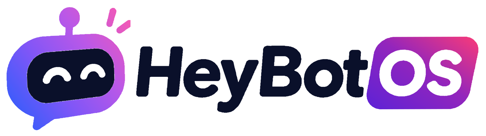
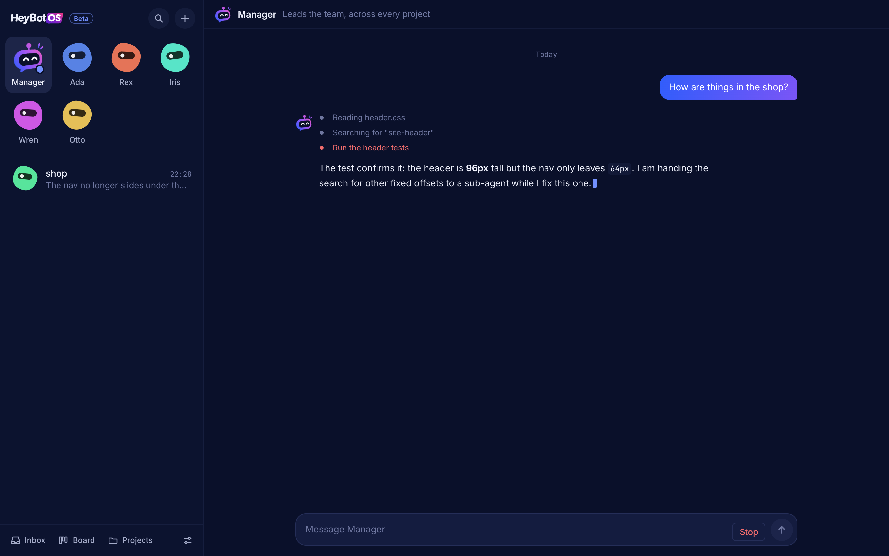
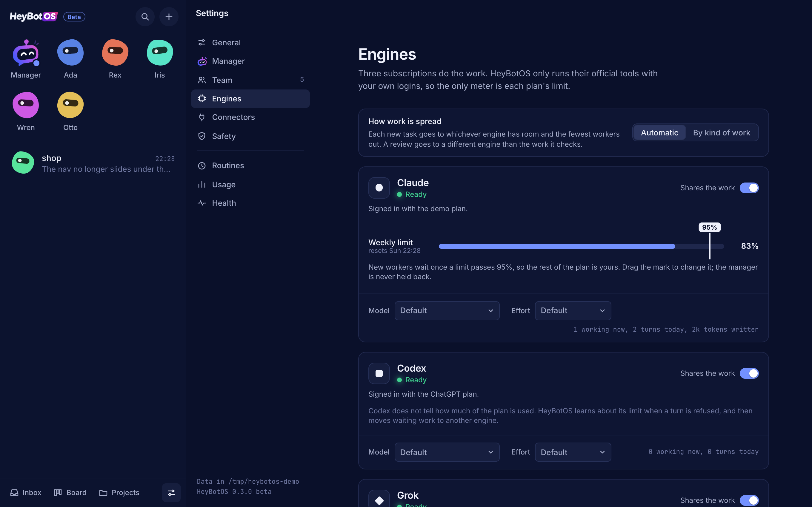

<p align="center">
  <picture>
    <source media="(prefers-color-scheme: dark)" srcset="docs/assets/logo-dark.png">
    
  </picture>
</p>

<p align="center"><strong>One manager you talk to. A team of agents that does the work.</strong></p>

> [!WARNING]
> **HeyBotOS is in beta.** It works and is used every day, but expect rough edges and changes between
> versions. Its workers edit files and run commands on your Mac without asking first: start with projects
> that are in git, where every change can be seen and undone, and keep backups of anything you care about.

HeyBotOS is a Mac app that runs a team of coding agents for you. You tell the manager what you want done, in
any of your projects. It splits the work into tasks, hands them to workers, keeps track, and comes back with
the result. You see every agent and every step, and you can undo what a worker changed.

It runs on the subscriptions you already have. The manager and the workers are the official command-line
tools (Claude Code, the Codex CLI, Grok Build), started on your own Mac with the logins they already hold.
HeyBotOS has no account, no key and no server of its own, and it never calls a model API.



## Install

```sh
brew install --cask jannikco/tap/heybotos
```

Then open HeyBotOS. The first time, it shows which of the three tools are installed and signed in, and asks
where your projects are.

You need macOS 12 or newer and at least one of these, installed and signed in with a subscription:

| Tool | Command it provides |
|---|---|
| Claude Code | `claude` |
| Codex CLI | `codex` |
| Grok Build | `grok` |

With more than one, HeyBotOS spreads the work across them and sends a review to a different engine than the
one that did the work.

> **The app is not notarised by Apple yet.** macOS will refuse to open it the first time. Open System Settings,
> go to Privacy & Security, and choose "Open Anyway" next to the message about HeyBotOS. You only do this once.

## What you get

| Screen | For |
|---|---|
| Conversations | Talk to the manager, in general or per project. Ask for anything; it answers when work is done or it needs you. |
| Team | Named workers with a role each (engineer, reviewer, researcher, writer, operator). Add your own, or reshape how one works. |
| Inbox | Requests waiting for your yes or no, and questions from workers. |
| Board | Every task by where it stands. |
| Projects | Your project folders, and the notes every worker in a project reads first. |
| Routines | Things the manager does by itself on a schedule. |
| Settings | Engines and their limits, connectors, what needs your approval, the look. |



## How workers are kept in check

Workers run without asking: they edit files and run commands in the project folder. What stands between that
and an accident:

- **You can see and undo it.** Before a task's first worker touches a git repository, HeyBotOS records the
  folder exactly as it is, without touching your branch or staging area. You see what changed since, and one
  button puts those files back.
- **One worker per repository** at a time. A task can ask for its own branch and folder to run alongside.
- **The gate.** Three kinds of action wait for your yes in the Inbox: connecting to a server that is not on
  your list (ssh, scp, sftp, rsync, mosh), deploy and publish commands, and connector calls that change
  something. It is a seatbelt against mistakes, not a sandbox.
- **Connectors are set up once and given per task.** Add an MCP server by web address or command in
  Settings. A worker gets none of them unless its task names them; then it reaches them through HeyBotOS on
  any engine, without ever holding their keys. Reads go straight through; calls that change something wait
  for your yes.
- **Subscriptions only.** Workers get a clean environment built from an allowlist, so no key variable can
  switch a tool to metered billing, and a turn that is not on the subscription login is stopped before it does
  any work.
- **Only this Mac.** The service listens on 127.0.0.1 only, and only talks to a browser that you signed in
  from this computer.

## Where things live

| What | Where |
|---|---|
| The app | `/Applications/HeyBotOS.app` (it carries the service; no Node needed) |
| Your data | `~/heybotos` (settings in `config/`, database and logs in `state/`, attachments in `files/`) |
| Background service | `com.heybotos.daemon`, set up by the app; it keeps workers and routines going when the window is closed |
| Terminal command | `heybotos open`, `status`, `logs`, `uninstall` |

To remove it: `brew uninstall --cask heybotos`. Your data in `~/heybotos` stays until you delete it (or
uninstall with `--zap`).

## Build from source

You need Node 26 and pnpm.

```sh
pnpm install
pnpm start             # builds the dashboard and runs the service in this terminal
pnpm heybotos open     # opens the dashboard with a sign-in link that works once
```

```sh
pnpm demo              # the real service on throwaway data with a stand-in CLI; port 4748
pnpm test              # unit tests; the stand-in CLI replays recorded runs, nothing is spent
pnpm e2e               # browser tests against the demo
pnpm typecheck
pnpm --filter @heybotos/desktop dist   # builds the Mac app into apps/desktop/dist
```

[CONTRIBUTING.md](CONTRIBUTING.md) has the layout of the code and the rules for changing it.

## Beta

This is a beta. It is used every day by the people who build it, on macOS; nothing else is supported yet.
Things will change between versions, sometimes in ways that need a manual step; [CHANGELOG.md](CHANGELOG.md)
says what changed. Bug reports and ideas are very welcome in the
[issues](https://github.com/jannikco/heybotos/issues).

## Licence

[MIT](LICENSE). The fonts and libraries it ships with are listed in
[THIRD_PARTY_NOTICES.md](THIRD_PARTY_NOTICES.md). Claude, Codex and Grok are products of their own companies;
HeyBotOS is not affiliated with any of them.
